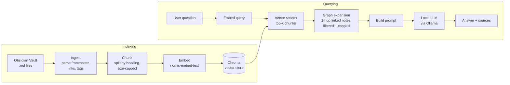

# Oracle

A fully local Retrieval-Augmented Generation (RAG) system over an Obsidian vault. Ask questions in natural language and get answers grounded in your own notes — with sources — without any data leaving your machine.

What makes Oracle *Obsidian* RAG rather than generic RAG: retrieval uses the vault's link graph (`[[wikilinks]]`) in addition to vector similarity, so related notes are pulled in the way you actually connected them.

> **Status:** in active development. Ingestion, chunking, and incremental indexing are implemented and tested; retrieval and question answering are in progress.

## Goals

- **Local-first**: embeddings, vector store, and LLM all run on-device (no cloud APIs)
- **Graph-aware retrieval**: expand vector search results with linked notes
- **Grounded answers**: every answer cites the notes it came from
- **Measured, not assumed**: an evaluation set to compare retrieval strategies against a baseline

## Architecture



## Tech Stack

| Component | Choice | Why |
|---|---|---|
| Language | Python 3 | Best ecosystem for RAG tooling |
| Model runtime | Ollama | Simple local model serving |
| Embeddings | `nomic-embed-text` | Small, strong, runs locally |
| LLM | `llama3.2` (configurable) | Fast enough on a laptop CPU; swap for a larger model if needed |
| Vector store | Chroma | Embedded, no server to run |
| Tests | pytest | Parsing and chunking are easy to get subtly wrong |
| API (planned) | FastAPI | Lightweight Python web server |
| UI (planned) | Streamlit or Gradio | Chat UI in a few lines |

## Project Structure

```
oracle/
├── sample-vault/        # demo vault so anyone can run the project
├── src/
│   ├── ingest.py        # parse notes, frontmatter, tags, links, backlinks
│   ├── chunking.py      # heading-based, size-capped chunks for embedding
│   ├── index.py         # embed chunks into Chroma; re-embeds only changed notes
│   ├── retrieve.py      # vector search + graph expansion              (planned)
│   └── query.py         # answer(question) -> answer + sources         (planned)
├── tests/               # pytest suite
├── eval/                # retrieval evaluation: recall@k, MRR          (planned)
├── DEVLOG.md            # dated progress log and design decisions
└── requirements.txt
```

## Getting Started

**Prerequisites:** Python 3.12+ and [Ollama](https://ollama.com).

```bash
# Models
ollama pull nomic-embed-text
ollama pull llama3.2

# Environment
python3 -m venv .venv && source .venv/bin/activate
pip install -r requirements.txt

# Parse the sample vault and print a summary of notes, links, and tags
python src/ingest.py --vault sample-vault

# Split it into chunks and preview the first few
python src/chunking.py --vault sample-vault --show 3

# Embed the chunks into a local Chroma index (re-runs only re-embed changed notes)
python src/index.py --vault sample-vault

# Run the tests
pytest
```

To parse your own vault, point `--vault` at it. Use `--exclude templates` to skip folders such as templates.

## Design Decisions

- **Chroma over pgvector**: single-user local app; no database server needed.
- **Heading-based, size-capped chunking**: notes are written in sections, so chunks stay coherent; the cap keeps long sections from dominating.
- **Fully local models**: privacy is the point; also makes it safe for sensitive notes.
- **Core logic as functions, interfaces as wrappers**: the CLI, API, and UI all call the same `answer()`, so adding an interface doesn't change the pipeline.
- **Baseline before graph expansion**: graph expansion can add noise as easily as signal, so it's only kept if it beats vector-only retrieval on the eval set.

See `DEVLOG.md` for the reasoning behind decisions as the project evolves.

## Results

_Retrieval benchmarks (vector-only vs. graph-aware) will be published here once the evaluation set is complete._
