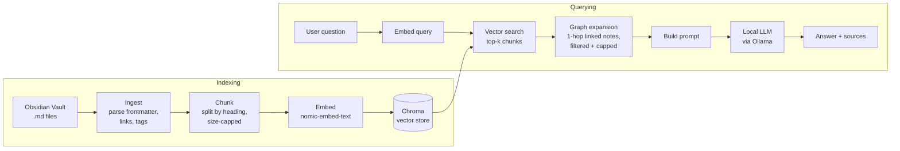

# Oracle

**Obsidian RAG** — a fully local Retrieval-Augmented Generation (RAG) system over an Obsidian vault. Ask questions in natural language and get answers grounded in your own notes — with sources — without any data leaving your machine.

What makes Oracle *Obsidian* RAG rather than generic RAG: retrieval uses the vault's link graph (`[[wikilinks]]`) in addition to vector similarity, so related notes are pulled in the way you actually connected them.

## Goals

- **Local-first**: embeddings, vector store, and LLM all run on-device (no cloud APIs)
- **Graph-aware retrieval**: expand vector search results with linked notes
- **Grounded answers**: every answer cites the notes it came from
- **Measured, not assumed**: an evaluation set to compare retrieval strategies against a baseline

## Architecture



## Tech Stack

| Component | Choice | Why |
|---|---|---|
| Language | Python 3 | Best ecosystem for RAG tooling |
| Model runtime | Ollama | Simple local model serving |
| Embeddings | `nomic-embed-text` | Small, strong, runs locally |
| LLM | `llama3.2` (configurable) | Fast enough on a laptop CPU; swap for a larger model if needed |
| Vector store | Chroma | Embedded, no server to run |
| Tests | pytest | Parsing and chunking are easy to get subtly wrong |
| API (Phase 4) | FastAPI | Lightweight Python web server |
| UI (Phase 4) | Streamlit or Gradio | Chat UI in a few lines |

## Project Structure

```
oracle/
├── README.md
├── DEVLOG.md            # dated progress log + design decisions
├── requirements.txt
├── .gitignore
├── sample-vault/        # demo notes so anyone can run the project
├── src/
│   ├── ingest.py        # walk vault, parse notes, links, tags
│   ├── chunk.py         # heading-based, size-capped chunking with metadata
│   ├── index.py         # embed chunks, store in Chroma (incremental)
│   ├── retrieve.py      # vector search + graph expansion
│   └── query.py         # answer(question) -> (text, sources); CLI wrapper
├── tests/
│   ├── test_ingest.py   # link/tag/frontmatter parsing
│   └── test_chunk.py    # chunk boundaries and size limits
└── eval/
    ├── questions.json   # question → expected source note pairs
    └── evaluate.py      # recall@k / MRR across retrieval strategies
```

## Roadmap

### Phase 1 — Setup
- [x] Create sample vault (15–20 linked notes)
- [ ] Install Ollama, pull `nomic-embed-text` and `llama3.2`
- [ ] Python venv, dependencies, `.gitignore` (keep real vaults out of git)

### Phase 2 — Minimal pipeline (CLI)
- [ ] `ingest.py`: parse notes, frontmatter, `#tags`, and links — including `[[note|alias]]`, `[[note#heading]]`, and `![[embeds]]`; skip `.obsidian/`
- [ ] `chunk.py`: split by heading, cap chunk size, prefix each chunk with note title + heading
- [ ] `index.py`: embed + persist to Chroma; re-embed only changed files (content hash), handle deletes
- [ ] `query.py`: `answer(question)` function returning answer + sources; thin CLI on top
- [ ] Tests for parsing and chunking
- [ ] Evaluation set (10–15 questions) and **baseline** retrieval scores (vector search only)

### Phase 3 — Obsidian-specific
- [ ] Graph expansion: add chunks from 1-hop linked/backlinked notes
- [ ] Keep only expanded chunks still relevant to the question; cap how many are added
- [ ] Compare against baseline (recall@k, MRR); record what helped and what didn't

### Phase 4 — Interface & polish
- [ ] FastAPI backend wrapping `answer()`
- [ ] Streamlit/Gradio chat UI
- [ ] Sources as `obsidian://` links that open the note
- [ ] File watcher for automatic re-indexing
- [ ] (Stretch) Obsidian sidebar plugin calling the local backend

## Getting Started

```bash
# 0. Prerequisites (Ubuntu/Debian)
sudo apt install python3-venv          # or python3.X-venv matching your Python
curl -fsSL https://ollama.com/install.sh | sh

# 1. Models
ollama pull nomic-embed-text
ollama pull llama3.2

# 2. Environment
python3 -m venv .venv && source .venv/bin/activate
pip install -r requirements.txt

# 3. Index the sample vault and ask a question
python src/index.py --vault sample-vault
python src/query.py "your question here"
```

## Design Decisions

- **Chroma over pgvector**: single-user local app; no database server needed.
- **Heading-based, size-capped chunking**: notes are written in sections, so chunks stay coherent; the cap keeps long sections from dominating.
- **Fully local models**: privacy is the point; also makes it safe for sensitive notes.
- **Core logic as functions, interfaces as wrappers**: the CLI, API, and UI all call the same `answer()`, so adding an interface doesn't change the pipeline.
- **Baseline before graph expansion**: graph expansion can add noise as easily as signal, so it's only kept if it beats vector-only retrieval on the eval set.

See `DEVLOG.md` for the reasoning behind decisions as the project evolves.

## Results

_To be filled in after Phase 3 evaluation._
