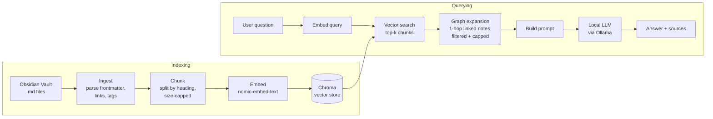

# Oracle

A fully local Retrieval-Augmented Generation (RAG) system over an Obsidian vault. Ask questions in natural language and get answers grounded in your own notes — with sources — without any data leaving your machine.

What makes Oracle *Obsidian* RAG rather than generic RAG: it understands the vault's structure — frontmatter, tags, aliases, and the `[[wikilink]]` graph — and measures whether following those links improves retrieval over vector similarity alone (see [Results](#results)).

> **Status:** in active development. The end-to-end pipeline works: ingestion, chunking, incremental indexing, vector and graph-aware retrieval, cited answers, and retrieval and answer-quality benchmarks. An Obsidian plugin provides the same features inside Obsidian.

## Goals

- **Local-first**: embeddings, vector store, and LLM all run on-device (no cloud APIs)
- **Graph-aware retrieval, measured**: test whether expanding results with linked notes beats vector search
- **Grounded answers**: every answer cites the notes it came from
- **Measured, not assumed**: an evaluation set to compare retrieval strategies against a baseline

## Architecture



## Tech Stack

| Component | Choice | Why |
|---|---|---|
| Language | Python 3 | Best ecosystem for RAG tooling |
| Model runtime | Ollama | Simple local model serving |
| Embeddings | `nomic-embed-text` | Small, strong, runs locally |
| LLM | `qwen2.5:7b` (configurable) | Most accurate in evaluation; `llama3.2` is ~2× faster with lower accuracy |
| Vector store | Chroma | Embedded, no server to run |
| Tests | pytest | Parsing and chunking are easy to get subtly wrong |
| API | FastAPI + Server-Sent Events | Streams answers to the web UI and the Obsidian plugin |
| UI | Single HTML page, plain JavaScript | No build step; same calls the plugin will make |

## Project Structure

```
oracle/
├── sample-vault/        # demo vault so anyone can run the project
├── src/
│   ├── ingest.py        # parse notes, frontmatter, tags, links, backlinks
│   ├── chunking.py      # heading-based, size-capped chunks for embedding
│   ├── index.py         # embed chunks into Chroma; re-embeds only changed notes
│   ├── retrieve.py      # retrieval: vector, BM25 keyword, hybrid, graph expansion
│   ├── query.py         # answer(question) -> answer + cited sources
│   ├── server.py        # local HTTP API: search, streamed answers, re-index
│   ├── evaluate.py      # score retrieval strategies: hit@k, recall@k, MRR
│   └── evaluate_answers.py  # score answers: facts, refusals, made-up answers, citations
├── web/index.html       # browser UI: Ask and Search tabs
├── obsidian-plugin/     # Obsidian sidebar panel (TypeScript) that talks to the server
├── tests/               # pytest suite
├── eval/                # question set and saved results
├── DEVLOG.md            # dated progress log and design decisions
└── requirements.txt
```

## Getting Started

**Prerequisites:** Python 3.12+ and [Ollama](https://ollama.com).

```bash
# Models
ollama pull nomic-embed-text
ollama pull qwen2.5:7b      # default answer model (~4.7 GB); llama3.2 is a faster alternative

# Environment
python3 -m venv .venv && source .venv/bin/activate
pip install -r requirements.txt

# Parse the sample vault and print a summary of notes, links, and tags
python src/ingest.py --vault sample-vault

# Split it into chunks and preview the first few
python src/chunking.py --vault sample-vault --show 3

# Embed the chunks into a local Chroma index (re-runs only re-embed changed notes)
python src/index.py --vault sample-vault

# Ask a question
python src/query.py "what learning rate worked best in my project?"

# Score retrieval against the question set
python src/evaluate.py --vault sample-vault

# Score answer quality (runs the LLM on every question; a few minutes)
python src/evaluate_answers.py

# Run the tests
pytest
```

**Web interface:** `python src/server.py --vault sample-vault`, then open <http://localhost:8000>. The **Ask** tab streams answers with numbered, clickable sources and flags any detail not found in your notes; the **Search** tab returns ranked sections instantly (hybrid search, no LLM). Sources open directly in Obsidian. The server only listens on `127.0.0.1`.

**Obsidian plugin:** a sidebar panel with the same Ask and Search tabs, inside Obsidian. Sources open the note at the cited section, and the index updates automatically when notes change. To build it (requires Node.js):

```bash
cd obsidian-plugin && npm install && npm run build   # installs into sample-vault/.obsidian/plugins/oracle
# for another vault: OBSIDIAN_PLUGIN_DIR="/path/to/vault/.obsidian/plugins/oracle" npm run build
```

Then in Obsidian: **Settings → Community plugins** → turn on community plugins → enable **Oracle**, and start the server for that vault.

**Guided demo:** `scripts/demo.sh` runs every step above on the sample vault, then lets you ask questions interactively. Pass a vault path to use your own: `scripts/demo.sh ~/path/to/vault`.

To parse your own vault, point `--vault` at it. Use `--exclude templates` to skip folders such as templates.

## Design Decisions

- **Chroma over pgvector**: single-user local app; no database server needed.
- **Heading-based, size-capped chunking**: notes are written in sections, so chunks stay coherent; the cap keeps long sections from dominating.
- **Fully local models**: privacy is the point; also makes it safe for sensitive notes.
- **Core logic as functions, interfaces as wrappers**: the CLI, API, and UI all call the same `answer()`, so adding an interface doesn't change the pipeline.
- **Baseline before graph expansion**: graph expansion can add noise as easily as signal, so it's only kept if it beats vector-only retrieval on the eval set.

See `DEVLOG.md` for the reasoning behind decisions as the project evolves.

## Results

Retrieval is evaluated on a 59-note sample vault with 31 development questions and 10 held-out questions written before the final strategy was chosen. The **evidence** score is the fraction of answer phrases present in the retrieved chunks, with every strategy given the same number of chunks (k).

| Strategy | Dev, k=3 | Dev, k=5 | Held-out, k=3 | Held-out, k=5 |
|---|---|---|---|---|
| Vector search | 0.89 | **0.97** | 0.80 | 0.90 |
| + note-level link expansion | 0.87 | 0.92 | 0.80 | **0.95** |
| + chunk-level link expansion | **0.90** | 0.92 | 0.80 | 0.90 |

**Finding:** at a fixed context budget, link expansion does not reliably beat vector search — differences are one or two questions in either direction. Linked notes are usually also semantically similar to the question, so vector search already finds them, and following links from the wrong section displaces good results. Following only the links inside the retrieved section is clearly better than following every link in the note. Full analysis in [`DEVLOG.md`](DEVLOG.md); raw results in [`eval/results/`](eval/results/).

### Compared with keyword search

How often each approach retrieves the passage containing the answer (evidence score, top 3 results):

| Search | Dev | Held-out |
|---|---|---|
| Obsidian-style search (every term must match) | 0.15 | 0.00 |
| Keyword ranking (BM25) | 0.85 | 0.75 |
| Vector search | **0.89** | 0.80 |
| **Hybrid** (vector + BM25, Reciprocal Rank Fusion) | **0.89** | **0.90** |

Typing a natural-language question into an all-terms-must-match search rarely finds the answer, and never for paraphrased questions; that's the gap semantic search fills. Hybrid search is the most accurate for the top few results and is used for ranked search; answers use vector search, which tied with hybrid at five results.

### Answer quality

Answers are graded on 46 development and 17 held-out questions: whether answerable questions mention the key facts, whether broad topics are summarized rather than refused, and whether unanswerable questions are refused rather than answered from the model's own knowledge.

| Setup | Fully correct (dev / held-out) | Made-up answers (all runs) | Avg time (CPU) |
|---|---|---|---|
| llama3.2 + strict prompt + topic rewrite | 0.88 / 0.80 | 0 of 9 | ~6 s |
| qwen2.5:7b + strict prompt | 0.91 / 0.90 | 2 of 9 | ~13 s |
| **qwen2.5:7b + strict prompt + grounding check (default)** | **0.91 / 0.90** | **1 of 9**¹ | ~13 s |

¹ The remaining case answered "calendar sync is next", which the notes do say; it's counted because the question was labelled unanswerable.

**Findings:** the larger model is more accurate, but it repeatedly answered from its training data and cited a note that didn't support the claim, and prompting didn't prevent it. A deterministic **grounding check** ([`src/grounding.py`](src/grounding.py)) extracts specific details from each sentence — numbers, code, names — and verifies them against the excerpts the sentence cites. It caught every fabrication observed, flagging about 4% of good answers (mostly acronyms the model spelled out itself). In `strict` mode, unsupported sentences are removed; `warn` keeps them and lists the unverified details.
