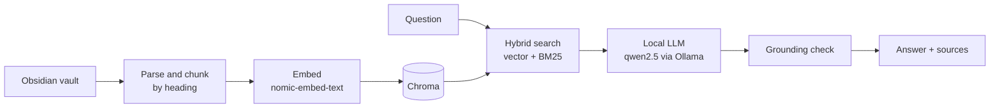

# Oracle

Ask your Obsidian notes questions and get answers that cite the notes they came from. Everything runs on your machine: no cloud APIs, no data leaves your computer.

## Key results

- **Hybrid search finds the answer most often:** 0.90 on held-out questions (top 3), vs 0.80 for vector search and 0.00 for Obsidian's built-in search.
- **A grounding check catches made-up answers.** The best model sometimes answered from its training data and cited a note that didn't support it. A deterministic check now verifies the specific details in each sentence against the cited notes. It caught every fabrication observed.
- **Following note links didn't help.** Expanding results with `[[linked]]` notes was no better than plain vector search, because linked notes are usually already semantically similar.

## How it works



**Stack:** Python · Ollama · Chroma · FastAPI · TypeScript (Obsidian plugin)

## Quick start

Requires Python 3.12+ and [Ollama](https://ollama.com).

```bash
ollama pull nomic-embed-text && ollama pull qwen2.5:7b
python3 -m venv .venv && source .venv/bin/activate
pip install -r requirements.txt

scripts/demo.sh                    # index the sample vault and ask questions
scripts/demo.sh ~/path/to/vault    # or use your own vault
```

**Web UI:** `python src/server.py --vault sample-vault`, then open <http://localhost:8000>.

**Obsidian plugin:** `cd obsidian-plugin && npm install && npm run build`, then enable **Oracle** under Settings → Community plugins and set its folder to this repo. It starts the server when Obsidian opens and keeps the index updated as you edit notes.

## Evaluation

Retrieval and answers are scored on a 59-note sample vault, with development questions and a held-out set written before the final setup was chosen.

| Answer setup | Fully correct (dev / held-out) | Made-up answers | Time (CPU) |
|---|---|---|---|
| llama3.2 | 0.88 / 0.80 | 0 of 9 | ~6 s |
| qwen2.5:7b | 0.91 / 0.90 | 2 of 9 | ~13 s |
| **qwen2.5:7b + grounding check (default)** | **0.91 / 0.90** | **1 of 9** | ~13 s |

Run them yourself with `python src/evaluate.py --vault sample-vault` (retrieval) and `python src/evaluate_answers.py` (answers). Full results and analysis are in [`DEVLOG.md`](DEVLOG.md) and [`eval/results/`](eval/results/).

## License

MIT
